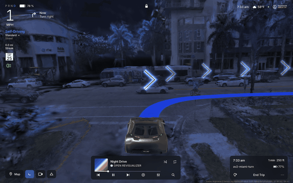
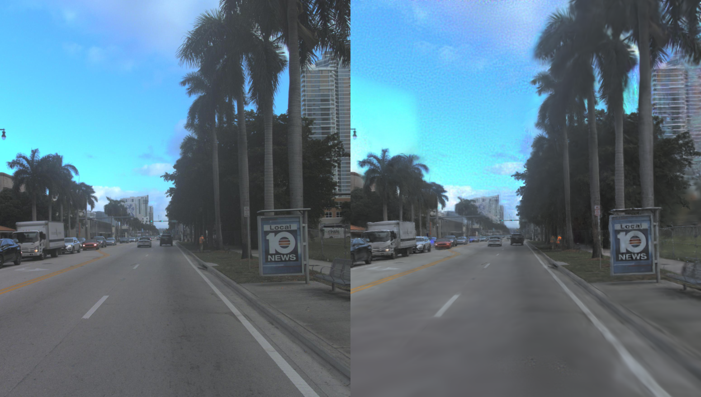

<div align="center">

# Open Revisualizer

**Re-render reality from a car's surround cameras, then drive through it like a video game.**

An open-source take on the "reality re-render" driving view: surround camera footage from a real drive becomes a dynamic 3D Gaussian splat, rendered live in the browser from a chase camera above the car, with a glowing route, turn chevrons in the sky and tap-to-go.

[**Live demo**](https://waleedsworld.github.io/open-revisualizer/) · [SDK](docs/SDK.md) · [Scene format](docs/SCENE_FORMAT.md) · [Train your own](train/README.md)



</div>

## What it does

- **7 surround cameras in, 3D world out.** A 10.5 s drive through a busy Miami intersection from the Argoverse 2 sensor set (7 ring cameras, lidar, poses) is reconstructed as a 3D Gaussian splat: 1.5M background Gaussians plus 45 moving vehicles, so other cars drive through the scene.
- **Any virtual camera, live.** The scene renders in real time in any WebGL2 browser (three.js + [Spark](https://sparkjs.dev)), from above and behind the car, top-down, or the hood.
- **Game-style car display.** Gear and speed cluster, Self-Driving status, turn-by-turn banner, speed limit, media and trip cards, a blue planned-path ribbon, and glowing chevrons in the sky before each turn. Turns are detected from the ego path itself.
- **Tap to go.** Tap anywhere in the scene and the car leaves the recorded route and drives there. The tap raycasts the splats themselves.
- **Dashcam strip.** Real footage from all cameras, synced to the 3D replay, in the same layout as an in-car dashcam viewer (Reality, Grid, each camera).
- **Night mode, 4 camera views, scrubbing, URL-driven capture** for clean video frames.

## Demo scene numbers

| | |
|---|---|
| Source | Argoverse 2 Sensor, val log `3de5b5d6…`, Miami, 7 ring cameras at 1024x775 |
| Segment | 10.5 s, 105 frames, pulling away from a stop into a 90° right turn |
| Model | drivestudio StreetGS: background + 45 rigid vehicles + sky, lidar depth loss |
| Training | 30,000 iterations, 55 min on one RTX 4090 (about $0.70 on Vast.ai) |
| Held-out quality | PSNR 23.0 dB, SSIM 0.66, LPIPS 0.36 (every 10th frame, all cameras) |
| Web payload | 84 MB background + 45 actor files (0.1–1.8 MB each) |



## Quick start

```bash
git clone https://github.com/waleedsworld/open-revisualizer
cd open-revisualizer
python3 -m http.server 8765 -d web
# open http://127.0.0.1:8765
```

No build step and no GPU. A laptop browser renders the scene at 60 fps.

| input | action |
|---|---|
| tap / click | drive to that point |
| drag · wheel · double-click | orbit · zoom · reset camera |
| `Space` · `←` `→` | play/pause · seek |
| `1`–`4` or `V` | reality / close / top / hood view |
| `C` · `N` · `H` | camera strip · night · hide HUD |

## Use it as an SDK

```js
import { createRevisualizer } from "./revisualizer.js";

const rv = await createRevisualizer({ container: document.getElementById("view"), scene: "scenes/av2-miami-turn" });

rv.on("frame", ({ speedMps, nextTurn }) => console.log(speedMps, nextTurn));
rv.setView("top");
rv.goTo(40, 12);       // drive to world (x, y), in metres
```

The full API (options, methods, events, URL params, recording) is in **[docs/SDK.md](docs/SDK.md)**.

## How it works

```
 Argoverse 2 log            drivestudio (GPU)                 export                 browser
 7 ring cameras  ─┐      ┌───────────────────────┐      ┌──────────────────┐     ┌─────────────────────┐
 lidar           ─┼────▶ │ background Gaussians  │ ───▶ │ background.ply   │ ──▶ │ Spark splat renderer │
 ego poses       ─┤      │ + one per moving car  │      │ actors/*.ply     │     │ chase camera + HUD   │
 3D boxes/tracks ─┘      │ + sky, lidar depth    │      │ tracks.json      │     │ path, chevrons, tap  │
                         └───────────────────────┘      └──────────────────┘     └─────────────────────┘
```

1. **Data.** [Argoverse 2 Sensor](https://www.argoverse.org/av2.html) is downloaded straight from its public S3 bucket, with no signup. The training scripts pick a daytime log with a clear turn and use its 7 ring cameras.
2. **Reconstruction.** [drivestudio](https://github.com/ziyc/drivestudio) fits a Street-Gaussians-style model: static background, one rigid Gaussian set per tracked vehicle, and a sky model, with lidar depth supervision. Sky masks come from SegFormer (Cityscapes).
3. **Export.** Gaussians go to standard 3DGS `.ply` files in a z-up world frame. Per-frame ego and actor poses go to `tracks.json` ([format](docs/SCENE_FORMAT.md)).
4. **Render.** `revisualizer.js` streams the splats with Spark, animates the actors, and draws the car, ribbon, chevrons and HUD on top.

### Compared with the in-car version

The production systems this imitates run a feed-forward generative model on the car computer. It turns the live camera feeds into a 3D scene every frame and can fill in what the cameras never saw. This repo optimises one model per clip offline (minutes on a single GPU) and then renders it in real time from any viewpoint. The viewer, scene format and UI do not care where the Gaussians come from, so a feed-forward model (STORM, DrivingForward) can be added as another exporter. That is the next item on the roadmap.

**Honest limits:** the cameras sit about 1.6 m above the road, so views from far above the car show less detail on rooftops and the far side of objects. Areas no camera saw (behind buildings, under parked cars) are empty or blurry. That is what a generative prior fixes.

## Train your own scene

See **[train/README.md](train/README.md)** for the exact commands: download one log, preprocess, sky masks, train, export. A single rented RTX 4090 is enough.

To try the viewer with no data at all:

```bash
python3 tools/make_synthetic_scene.py web/scenes/synthetic   # procedural test town
```

## Roadmap

- [ ] Feed-forward exporter (STORM / DrivingForward) for clips with no per-scene training
- [ ] Generative infill (video diffusion) for regions the cameras never saw
- [ ] nuScenes, Waymo and PandaSet loaders (drivestudio already supports them)
- [ ] Forward-only mode for comma.ai footage (comma2k19 / openpilot logs, 2 road cameras)
- [ ] Phone-friendly LOD streaming for long drives

## Credits and licences

- Code: MIT (this repo).
- Demo scene: derived from [Argoverse 2](https://www.argoverse.org/), CC BY-NC-SA 4.0 (non-commercial; derived scene data keeps that licence).
- Car model: [Car Concept](https://github.com/KhronosGroup/glTF-Sample-Assets/tree/main/Models/CarConcept) from the Khronos glTF Sample Assets, CC BY 4.0, based on a CC0 model by Unity Fan.
- Rendering: [three.js](https://threejs.org) (MIT) and [Spark](https://github.com/sparkjsdev/spark) (MIT).
- Reconstruction: [drivestudio](https://github.com/ziyc/drivestudio), [gsplat](https://github.com/nerfstudio-project/gsplat), [SegFormer](https://github.com/NVlabs/SegFormer).

An independent open-source project, not affiliated with any car maker.
